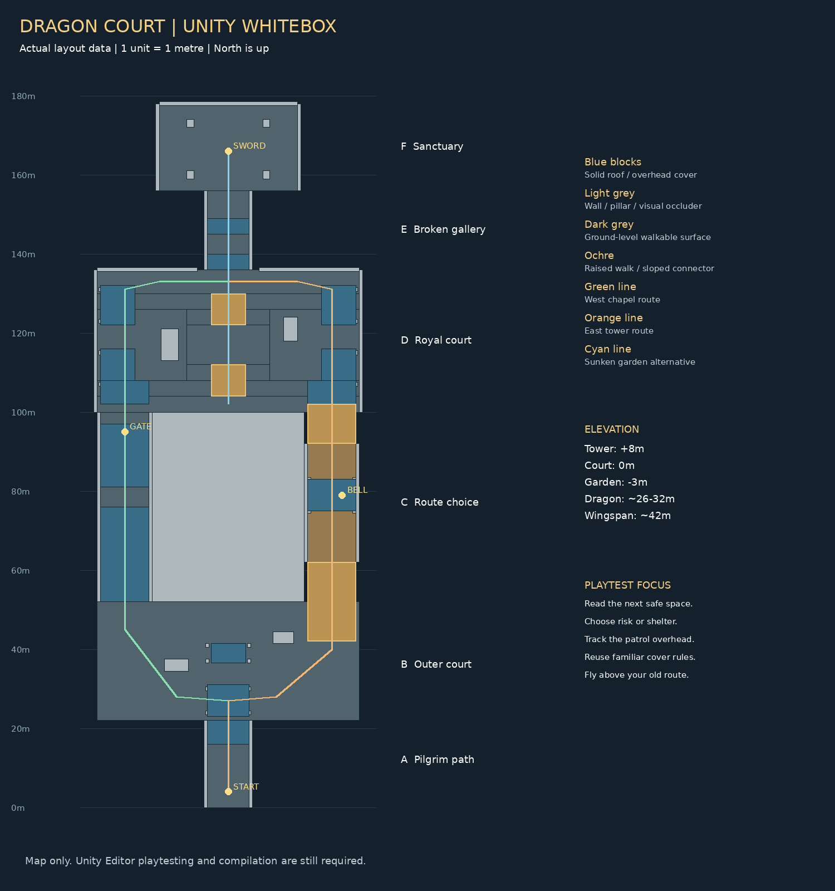

# 龙眠王庭｜Unity 关卡白盒

一个第三人称潜入探索原型：避开盘旋巨龙，穿过废弃王庭，拔出圣剑，再乘龙飞越来时的路。

**这是有场景入口、生成器与玩法代码的 Unity 白盒工程。当前交付环境未安装 Unity，尚未完成 Unity 编译、实际试玩或可执行程序打包。** 地图采样检查通过不等于引擎内验证通过。



## 打开与试玩

1. 安装 **Unity 2022.3 LTS**；工程记录版本为 `2022.3.62f1`。使用内置渲染管线，不需要 URP、第三方角色包或外部模型。
2. Unity Hub → Add project from disk → 选择包含 `Assets`、`Packages`、`ProjectSettings` 的本文件夹。
3. 等待脚本导入。打开 `Assets/DragonCourt/Scenes/DragonCourt.unity`，点击 Play；入口场景会在运行时生成整张地图。
4. **需要在 Scene 窗口查看和编辑白盒时**，退出 Play，执行菜单 **Dragon Court → Generate Editable Whitebox**。生成器会保存 `DragonCourt_Editable.unity` 和所需网格、材质资源，并将其设为构建场景。
5. 生成后可以逐块修改几何体，再 Play。再次执行生成会替换生成场景，工具会弹出提醒；手工修改前建议 Save As 为自己的版本。
6. 若要打包，先完成下方验收，再通过 File → Build Settings 选择本机目标平台构建。

入口场景在编辑态只有生成器对象，这是预期行为。想看完整地图请执行第 4 步；生成后的可编辑场景不依赖运行时生成器。

如导入已有项目，需启用旧输入系统：Player Settings → Active Input Handling 选择 **Input Manager (Old)** 或 **Both**。工程使用 `Input.GetKey`，不要求配置任何输入轴。

## 操作

| 操作 | 按键 |
|---|---|
| 移动 | WASD |
| 观察 | 按住鼠标右键拖动，或方向键 |
| 冲刺 / 蹲伏 | 左 Shift / 左 Ctrl 或 C |
| 交互 | E |
| 返回检查点 | R |
| 感知辅助线 | F1，并在 Scene 窗口开启 Gizmos |
| 调试俯视图 | F2 |
| 结尾左右观察 | Q / E |

首次鼠标观察没有锁定光标，方便调试；Game 窗口需取得焦点。没有跳跃和战斗。窗口化程序 Esc 退出；编辑器使用 Play 按钮结束。

## 已编写的内容

- 六段连续空间：山道、外庭、双路线、中央庭院、断顶回廊、圣剑殿。
- 低位礼拜堂路线与 +8 米钟楼路线；中央庭院有 -3 米下沉花园与双侧拱廊。
- 83 个基础几何体、4 段真实坡道；地图数据由 JSON 驱动。
- 约 42 米翼展的几何体巨龙、巡游/警觉/搜索/龙息状态、射线遮挡与发现值。
- 钟楼诱导交互、礼拜堂壁画、可开启并在失败后保持开启的栅门。
- 失败重试、区域检查点、圣剑交互、登龙过渡与约 48 秒固定路径飞行。
- 第三人称角色、镜头避障、蹲伏、HUD 和调试俯视图。

蓝色顶棚表示实体遮挡，金色表示目标或交互；灰色为基础建筑。**是否遮住巨龙取决于真实射线：在屋檐边缘或从敞口被斜向观察时仍可能暴露。普通暗色地面不提供隐身。** 圣剑殿是规则明确的终点安全区。

HUD 暂用英文，避免依赖本机中文字体；说明文档为中文。巨龙和角色都是几何体替身，没有成品模型、动画资源、龙息粒子或音效。

## 推荐首轮流程

山道出生 → 外庭观察巡游 → 左转礼拜堂，或右转登钟楼 → 在中央庭院选择侧拱廊/下沉花园 → 穿越断顶回廊 → 圣剑附近按 E → 登龙并飞回起点上空。

西侧经过金色栅门时按 E 开门。钟楼金色物体附近按 E 可诱导巡游中的龙；冷却 35 秒，诱导 11 秒，警觉或搜索时不可使用。

## 验证与下一步

当前机器已运行：

```bash
python3 tools/validate_whitebox.py
```

这会检查实际地图 JSON 的尺寸、坡度、三条候选通行路线的地面连续性和站立空间，以及出生点、检查点、终点位置。生成地图图片可运行 `python3 tools/validate_whitebox.py --map`，需要 Pillow。工具不需要加入 Unity 项目的运行依赖。

**Unity 内仍需完成：** 导入无编译错误；生成编辑场景；分别走通东西路线；进入并离开下沉花园；验证检测与实体遮挡；确认龙息与重试；拔剑后完整观看飞行；重新打开生成场景验证材质/网格保存；最后打包运行。

详细关卡意图见 [Docs/关卡白盒说明.md](Docs/关卡白盒说明.md)，验收清单见 [Docs/试玩验收.md](Docs/试玩验收.md)。初始地图尺度与巡游节奏需要真实试玩调参，尚不主张已经达到固定游玩时长。
